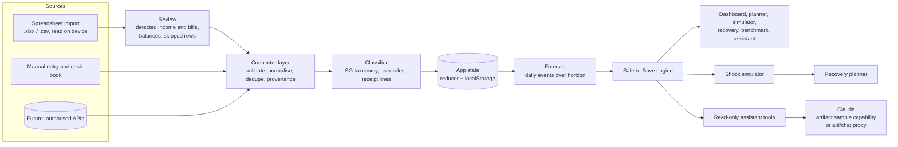

# SavvyMoni architecture

## Overview

SavvyMoni is a client-side React application with a pure-TypeScript domain core. Records come from the user (an imported spreadsheet, a cash book, manual entry), are processed in the browser and stored in `localStorage`. The only server component is `api/chat.ts`, an optional proxy that lets the AI assistant reach Claude without exposing an API key; inside a Claude artifact the assistant uses the viewer's own Claude account instead.



| Layer | Path | Responsibility |
|---|---|---|
| Domain | `src/domain` | Money (integer cents), dates (UTC date-only, "today" in the market's time zone), categories, classifier, spending estimates, forecast, engine, goals, shocks, recovery, benchmark, CSV parsing. No React, fully unit-tested. |
| Import | `src/import` | `.xlsx` reader/writer, workbook import (`workbook.ts`), regular-payment detection (`detect.ts`), applying a reviewed import (`build.ts`), template/sample/export workbooks (`samples.ts`). |
| Assistant | `src/ai`, `api/chat.ts` | Read-only tools over live state, instructions, provider detection, tool loop; server proxy. |
| Connectors | `src/connectors` | `FinancialDataConnector` interface and the provider catalogue with honest statuses. |
| Sample generator | `src/data/personas.ts` | Deterministic synthetic histories. Never loaded into the app directly: used to generate the downloadable sample workbooks (which go through the normal import) and as test fixtures. |
| State | `src/state` | Pure reducer for every action, recommendation-change log, persistence, React context, hash router. |
| UI | `src/ui`, `src/pages` | Components, SVG charts, pages. |
| Config | `src/config/markets.ts` | ASEAN market settings. |

## The Safe-to-Save engine

`src/domain/engine.ts` (`computeRecommendation`) is deterministic: the same state and date always give the same answer.

### 1. Build dated cash events (`forecast.ts`)

For each day `d` in the planning horizon `H` (default 35 days, from today):

- **Income.** Each payment from each income source, on its scheduled date plus an optional "late pay" delay. Overdue pay is assumed to arrive tomorrow, never today. Counted amount depends on certainty:
  - confirmed: 100%
  - expected: `1 − variability` (e.g. gig payouts swinging ±35% are counted at 65%)
  - uncertain: 0% (shown, never relied on)
  - payments that fall inside an applied shock's income-loss window are removed.
- **Bills.** Every unpaid occurrence of every recurring or one-off bill. Overdue bills are treated as due today. Monthly schedules are computed from the anchor date so 31 Jan → 28 Feb → 31 Mar does not drift.
- **Medical bills.** Only the out-of-pocket part: billed − subsidy − insurance − MediSave, where each deduction is counted only if entered.
- **Everyday essentials.** Average daily essential spending over the last 28 days, excluding transactions that are tracked bill payments (recurring-payment detection prevents double counting). Mixed receipts are split by line. Unclassified spending counts as essential. If history covers fewer than 14 days or 5 transactions, the profile estimate is used and confidence drops.
- **Discretionary allowance.** A user-set share (default 100%) of usual discretionary spending.

### 2. Project balances

`B(d) = liquid cash + Σ(inflows − outflows up to and including d)`. Emergency savings are not counted as spendable.

### 3. Find the safe maximum

```
maxSafe = max(0, min over d of B(d) − reserve)
```

A contribution `c` made today lowers every `B(d)` by `c`, so `c ≤ maxSafe` is exactly the condition that no projected day falls below the minimum cash reserve. The binding day is reported as the **limiting factor**, with the largest protected payment before it and the next counted income after it.

### 4. Recommend

- Confidence (high/medium/low) from: share of income that is confirmed, income variability, whether spending is measured or estimated, and data warnings.
- Recommended = `max(S$5, round-down-to-S$5(maxSafe × share))`, where share is 80% / 60% / 50% by confidence; zero if `maxSafe < S$10`, the user has paused, or information is insufficient.
- **Cushion** = `maxSafe − recommended`. It is shown as "kept as a cushion, not spare money": it stays in spending money to absorb forecast error (low pay, higher costs). When the user records a saving, the cushion and the next check-in date are stored (`AppState.cushion`). At that check-in, if the money wasn't needed, the overview offers to save it, capped at that day's safe maximum and rounded down; if cash is tighter than forecast it says the cushion was used.

### Savings history (`history.ts`)

The trend chart shows only what the records support. Today's emergency balance is known; earlier balances are worked out backwards from savings recorded in the app and from transfers to or from an emergency account found in imported transactions (matched by the account's name or a savings-transfer category; a transfer also recorded in the app is counted once). With such transfers the line starts at the beginning of the imported statement; without them it starts on the setup date. Today's figure is never copied backwards.
- Capped by a user-selected weekly target or user-selected goal. Auto-ladder milestones are progress markers, not caps.
- Status: *Insufficient information*, *Pause savings*, *Rebuild emergency buffer* (after a recent withdrawal), *Reduce contribution* (target not safe), *Save cautiously* (lower confidence or thin margin), *Safe to save*.
- Returns the explanation waterfall, assumptions, protected items, missing information, next review date (next payday within a week, else +7 days) and both projections.

### Core invariant

> Never recommend a positive contribution that would push any projected day below the reserve within the horizon.

`tests/engine.test.ts` checks this on 400 randomised states (mixed frequencies and certainties, overdue items, negative balances, random reserves, horizons and delays).

### Shock simulation (`shock.ts`)

Applying a shock to a copy of the state:

1. Emergency savings fund as much of the cost as they hold, moved into spending cash today (recorded as a withdrawal).
2. The full cost is added once, as a one-off protected bill on the shock date. Cash therefore goes up by the withdrawal and down by the cost on its date: nothing is counted twice.
3. Income-loss days are stored on the shock and removed from the forecast.
4. If the projection still dips below the reserve, remaining savings top up cash only by the amount needed.

The simulator and the "Apply to my plan" action use the same function, so what you preview is exactly what is applied.

### Recovery (`recovery.ts`)

Monthly surplus = take-home income (scenario view of certainty) − protected bills − everyday essentials − discretionary spending. Weekly rebuild = surplus × 12/52 × share (50/70/90%), rounded down to S$5. Week 1 is capped at today's safe maximum; optional pause weeks come first. Output is a week-by-week schedule and estimated date, labelled as a simulation.

### Benchmark (`benchmark.ts`)

A seeded 26-week history (pay pattern, ±volatility, ±10% essentials, ±25% discretionary, monthly bills, a dental bill in week 9, plus an income dip or family expense) is generated once and shared by all strategies. Each week: pay arrives, the strategy transfers (never more than available cash), expenses are paid, savings rescue any negative cash, and anything left unpaid counts as an essential shortfall. The adaptive strategy only uses information available that week; an income change is not known until it happens.

## Data model

Defined in `src/domain/types.ts`:

`Profile`, `Household`, `Account` (spending or emergency), `IncomeSource`, `IncomeEvent`, `RecurringBill`, `Transaction` (+ `TransactionLine` for mixed receipts), `HealthBill`, `SavingsContribution`, `SavingsGoal`, `FinancialShock`, `RecoveryPlan`, `ConnectorState`, `UserConsent`, `UserRule`, `Settings`, `RecommendationSnapshot`, `AppState`. Forecast, projection and recommendation explanation types live in `forecast.ts` and `engine.ts`.

- **Provenance.** Every account, income source, bill, transaction and medical bill carries `source: user | imported | simulated | estimated`, and transactions and bills carry a confidence level. The UI shows a badge for each.
- **Money.** Integer cents everywhere; user input is parsed from strings without floating point.
- **Dates.** ISO `YYYY-MM-DD` strings with UTC arithmetic; "today" is computed in `Asia/Singapore`.
- **Change log.** Every action that changes the recommendation appends a snapshot with a plain-language reason, which powers "why did my number change?".

## Connector abstraction

```ts
interface FinancialDataConnector {
  getMetadata(): ProviderMeta;                 // id, category, honest status, formats, note
  getConnectionStatus(state): ConnectionInfo;  // connected, consent, last sync, record count
  importTransactions(state, input, today): ImportResult;
  normaliseRecords(raw, today): Transaction[];
  validateRecords(records, today): ValidationResult;
  disconnect(state): AppState;                 // removes this provider's data and consent
}
```

Implemented: `SpreadsheetConnector` (wraps the workbook importer) and `ManualEntryConnector`. There are no simulated connectors. Provider statuses are fixed in `providers.ts`: no provider is labelled "Connected through an authorised API". See INTEGRATION_ROADMAP.md.

## Spreadsheet import

**Reading.** `.xlsx` and `.csv` only (`.xls` and macro-enabled `.xlsm` are refused with instructions), 5 MB and 10,000-row limits. The `.xlsx` reader walks the ZIP central directory, inflates parts with the browser's `DecompressionStream`, and reads cached cell values (shared strings, inline strings, numbers, booleans). Formulas, macros and external links are never evaluated; a formula without a stored value reads as empty. CSV uses a hand-written RFC 4180 parser. No `eval` or dynamic code anywhere.

**Finding the table.** The header row is searched for in the first 20 rows, so bank exports with title lines work. Recognised columns (English, Malay and Filipino words): date; description; either a signed amount (optionally with an In/Out type column) or separate money-out and money-in columns; optional category and account. Excel serial dates, `YYYY-MM-DD`, `DD/MM/YYYY`, `DD-Mon-YYYY` and ISO timestamps are accepted. Amounts from `.xlsx` number cells are exact; text amounts use the country's format (so `25.000` is twenty-five thousand rupiah). Total and balance summary rows are skipped.

**Validation.** Per row, with sheet and line numbers: unreadable or future dates, empty descriptions, unreadable, zero or implausibly large amounts. Spreadsheet-formula prefixes are stripped from text. Duplicates are detected within the file and against existing records. A user's own category word ("Makan", "Rent", "Load") is mapped to the taxonomy; the sign of the amount wins over a contradictory category (a positive amount in a spending category is treated as a refund).

**Optional sheets.** *Income* (source, type, amount, frequency, next date, certainty, varies by %), *Bills* (bill, category, amount, frequency, next due, priority, auto-debit) and *Balances* (account, type, role, balance). Next dates in the past roll forward; a bill overdue by up to a week stays overdue so it is protected now.

**Detecting regular payments** (`detect.ts`) when Income or Bills sheets are absent. Transactions are grouped by payee (lower-cased, reference numbers and month names removed). A group is a candidate when the median gap between payment days falls in a band (daily 1–2 days, weekly 6–8, fortnightly 13–16, monthly 27–33), at least 60% of gaps fit, there are enough occurrences (8 daily, 3 weekly, 2 fortnightly or monthly), and the last payment is recent (within about 1.6 intervals). Income uses the median amount and a measured variability (twice the mean absolute deviation, capped at 60%), which the engine discounts as for any expected income; salary-like steady pay is marked confirmed, patterns seen only twice or swinging 40%+ are uncertain and offered unticked. Bills use the highest recent amount; groceries, meals and everyday fares are never turned into bills (they are everyday spending), and unknown payees qualify only with a steady amount. Each candidate carries its evidence for the review screen.

**Applying.** Nothing is saved until the user confirms. Accounts are matched by name; balances are required for any account without one (zero is allowed). Past payments of detected bills are linked (`billId`) so the everyday-spending estimate does not count them again. When the history is shorter than two weeks, the user's own estimate of daily essentials is used until there is more data. Later imports merge into existing records and can update balances.

**Round trip.** `exportWorkbook` writes the user's records in the same layout (real Excel dates, a frozen header row), so they can be edited elsewhere and re-imported. Tests check a workbook written by openpyxl and a copy re-saved by LibreOffice.

## Assistant

The assistant is Claude, with no pre-written answers. `src/ai/tools.ts` defines ten read-only tools that run against the state **at the moment Claude calls them**: `get_plan_summary`, `get_accounts`, `get_income`, `get_bills`, `find_transactions`, `get_spending_summary`, `get_cash_projection`, `simulate_emergency`, `simulate_change` and `plan_rebuild`. Each returns small plain data with money already formatted in the country's currency, computed by the deterministic engine. Simulations run on a copy of the state; no tool can change records.

The instructions (`systemPrompt`) require facts to come from tools, forbid recommending more than the engine's safe amount or skipping protected payments, treat transaction text as data rather than instructions, decline investment, tax, legal and medical advice, and point to public assistance without promising eligibility.

Providers (`src/ai/assistant.ts`):
- **Artifact:** `claude.use("sample")` with the tools passed as page functions; Claude runs on the viewer's account after they allow it. If a view cannot run page tools, a compact snapshot of the same tool outputs is sent instead.
- **Server:** the browser posts the conversation and tool definitions to `/api/chat`; the function adds the API key, fixes the model (`ANTHROPIC_MODEL`, default `claude-sonnet-5-5`) and `max_tokens`, accepts only SavvyMoni's tool names, limits body size and rate, and returns Claude's content. The browser runs requested tools locally and sends results back, up to six rounds.
- **None / offline:** the page says the assistant is not connected. There is no fallback text generator.

Consent: the assistant is off until the user reads what is sent (the question, earlier messages in the chat, and the records looked up) and switches it on; the time is stored in settings and can be revoked. Each answer lists the data it looked at. Answers are rendered with a small Markdown subset built as React elements (no HTML injection).

## Security, privacy and regulatory notes

What the MVP does:

- No built-in records; never asks for bank passwords, Singpass credentials, NRIC, card security codes or health records, and the template warns against putting them in files.
- Imported files are processed in the browser and never uploaded; export (Excel, JSON) and deletion are available.
- The only data that leaves the device is what the AI assistant sends to Claude when the user asks something, after explicit opt-in. The API key never reaches the browser.
- Local storage is **not** encrypted. The MVP does not claim production-grade compliance.

What production would require:

| Area | Requirement |
|---|---|
| PDPA | Purpose limitation, consent and withdrawal, access and correction requests, Data Protection Officer, data breach notification process, transfer limitation for any cross-border processing |
| MAS | Regulatory review of whether the service constitutes financial advice or another regulated activity; outsourcing and technology risk management expectations if delivered through a bank partner |
| Provider agreements | Written API agreements with each data provider covering scope, consent flows, security and audit |
| Consent management | Granular per-provider consent, expiry, revocation that deletes data, consent records kept for audit |
| Encryption | TLS in transit; encryption at rest with managed keys; field-level encryption for sensitive identifiers |
| Authentication | Strong customer authentication (passkeys or MFA); Singpass only through approved integration |
| Access control | Least privilege, role-based access for staff, audited access to customer data |
| Retention | Documented retention periods, automatic deletion of raw transactions after derivation where possible |
| Incident response | Runbook, severity levels, PDPA breach assessment and notification within the statutory deadline, provider and regulator notification paths |
| Secure deployment | CI with dependency scanning, CSP, secrets management, penetration testing before pilot |

## Country configuration and offline operation

- `AppState.marketCode` selects a `MarketConfig` (`src/config/markets.ts`). The engine reads currency, rounding step, minimum actionable amount and milestones from it; everything else in the engine is unchanged. Amounts are integers in each currency's minor unit (cents for SGD/PHP, whole kyat for MMK).
- Domain functions format text with the state's own currency; UI components use the active currency set by the store.
- Each country's state is stored in its own slot (`savvymoni:v1:country:XX`). `switchCountry` parks the current state and loads the target's saved state, or an empty one that starts at setup, so records are never converted.
- Frequencies include `daily` for vendors and daily-paid workers; a "Work & business costs" category protects stock, stall rent, fuel and tools.
- The cash book writes `Transaction`s with `providerId: 'cash-ledger'` and adjusts the chosen cash or e-wallet balance; recording sales against an income source advances that schedule.
- `public/sw.js` caches the app shell (network-first, cache fallback) and never touches `/api/`. Import, cash book and calculations do not use the network, so the app works offline after one visit; only the assistant needs a connection. Verified by E2E flow M.

## ASEAN localisation

The engine is currency-agnostic: integer minor units, dates and flows. `src/config/markets.ts` captures what changes per market (currency and minor units, locale, payment rails, income rhythms, data protection law, cash-heavy flag). For cash-heavy or less connected markets the same engine works from manual entries and cash-envelope accounts; daily-wage income would use the existing daily grid with a daily income frequency. Categories and merchant rules are per market and must be researched locally rather than copied from Singapore.

## Testing

- `tests/engine.test.ts`: zero/negative income, zero expenses, expenses over income, late and overdue salary, upcoming rent, medical bills with and without MediSave, insufficient cash, volatility, uncertain income, overlapping recurring bills, month-end schedules, pause, reduce, randomised invariant, currency precision.
- `tests/data.test.ts`: missing transactions, duplicate detection, re-importing the same file, bill/transaction double counting, invalid files, malformed rows, formula injection, category overrides and merchant rules, mixed receipts, contributions and withdrawals, shock accounting, persistence, start again.
- `tests/import.test.ts`: xlsx write/read round trip, Excel dates, a compressed openpyxl workbook with title rows and Money out/in columns, local-language headers, In/Out type columns, category words, Income/Bills/Balances sheets, detection on all three sample workbooks, bill-payment linking, the safety invariant on imported plans, merging later imports, Excel export round trip, cash-book start, empty first run.
- `tests/ai.test.ts`: tools match the engine and see changes immediately, what-ifs never mutate state, search and totals, server tool loop (scripted responses), artifact path (mock `sample`), provider detection, proxy limits (no key, foreign prompt, unknown tool, fixed model and token limit).
- `tests/journeys.test.ts`: flows at state level, including setup from a workbook and importing a bank CSV.
- `scripts/e2e.mjs`: flows A–O in a real browser (including a real file upload and the assistant against a scripted `/api/chat`), mobile overflow check, console error check, offline reload.
